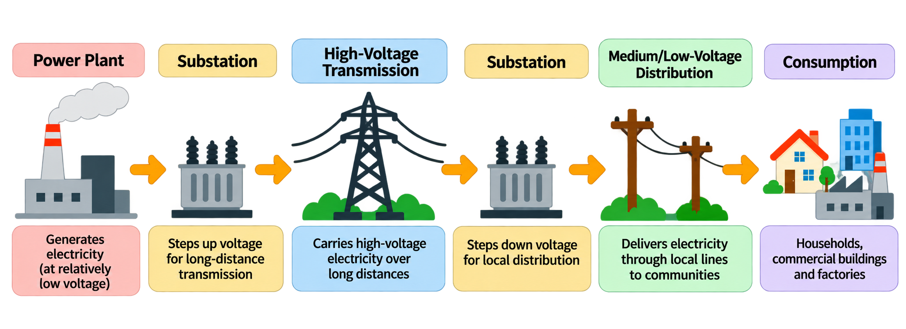
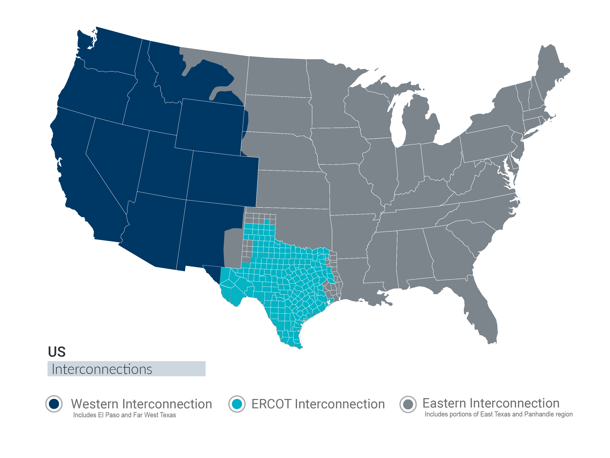
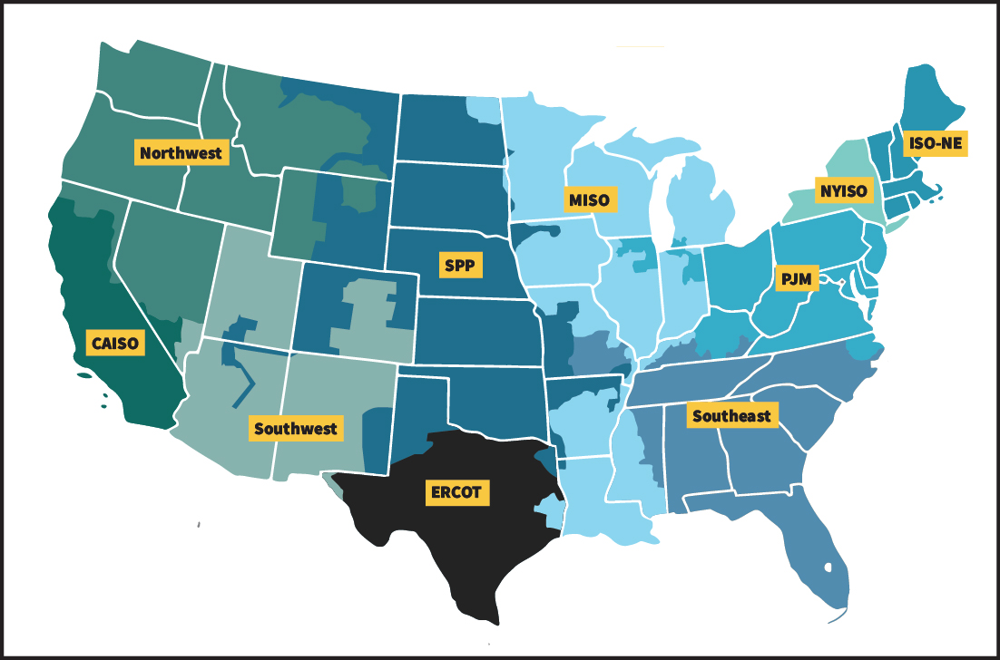

I'm curious about the [electrical grid](https://gridterms.org/terms/power-grid/). The grids around the world are, in a way, the biggest machines humanity has ever created. And it seems to me that there are bottlenecks in the grid holding us back from realizing electricity that's too cheap to meter. This piece is the beginning of an exploration into energy, starting with the grid and how it works. [0]

### How is electricity transported?

The grid is just a bunch of wires and electrical equipment coordinating the safe and reliable transport of electricity from generation to consumption. The "safe and reliable" part is where things get complicated.

At a high level, the main steps of power moving from the plant to your house are as follows:

Power plant -> substation -> high-voltage [transmission](https://gridterms.org/terms/transmission/) -> substation -> medium/low-voltage [distribution](https://gridterms.org/terms/distribution/) -> you.

We tend to produce electricity in large industrial facilities far away from homes and businesses, so electricity often has to travel long distances. Wires have resistance that reduces the power that ends up at the final destination. For long-distance transport, the grid steps up the voltage to mitigate this resistance. Why and how does that work?

[Power](https://gridterms.org/terms/power/) is [voltage](https://gridterms.org/terms/voltage/) across a component times [current](https://gridterms.org/terms/current/) through it:

$$
P = VI
$$

For the wire itself, the relevant voltage is the voltage drop along the wire, which [Ohm’s law](https://en.wikipedia.org/wiki/Ohm%27s_law) gives us:

$$
V_{\text{drop}} = IR_{\text{wire}}
$$

Substituting into the power equation gives the power lost as heat:

$$
P_{\text{loss}} = V_{\text{drop}}I = (IR_{\text{wire}})I = I^2R_{\text{wire}}
$$

Meanwhile, the power being transmitted is approximately:

$$
P_{\text{transmitted}} = V_{\text{transmission}}I
$$

For the same transmitted power, increasing transmission voltage reduces current. That smaller current reduces the wire’s heating losses quadratically (e.g., a 10x reduction in current leads to a 100x reduction in power loss).

If we want to reduce power lost, it's most effective to reduce current. And if we want to reduce current at fixed power, we can increase voltage. [1] And since wires are only able to withstand certain quantities of current, stepping up the voltage allows the grid to transmit more power across longer distances with cheaper wires.

However, high voltage brings some complexities. High voltage increases the strength of the electric field, which can allow for electricity to move through things we'd normally consider non-conductive, like air. So each wire needs to keep a large clearance from other wires, people, vehicles, and buildings. There are even [ceramic insulating discs](https://gridterms.org/terms/insulator/) separating the wires from the transmission pylons holding them up, and vegetation needs to be cleared and maintained to prevent tree growth from taking down power lines or wires from arcing with trees and starting a fire. The electric field is also strong enough to produce audible buzzing through [corona discharge](https://en.wikipedia.org/wiki/Corona_discharge) that needs to be mitigated in real lines.

Local distribution is another complex piece that I didn't have time to fully explore yet. Although these lines don't run at nearly as high voltages as long-distance transmission lines, they are much more exposed to clustered built environments (houses, businesses, trees, animals, highways), which can be more difficult to maintain and upgrade. Meanwhile, distributed energy resources (DER) such as [rooftop solar](https://gridterms.org/terms/solar-photovoltaic/) and [home batteries](https://gridterms.org/terms/battery-storage/) are further complicating local utilities in return for their own benefits.

[Substations](https://gridterms.org/terms/substation/) are connection points for both transmission and distribution lines loaded with a variety of electrical equipment to operate the grid. They include [transformers](https://gridterms.org/terms/transformer/), which are the devices that step up and down voltage. They also include relays, switches, and [breakers](https://gridterms.org/terms/circuit-breaker/). Relays are devices that detect current and voltage on a line and trigger actions on other lines. Example: an electromechanical relay would react to current coming in at one end to power an electromagnet that commands something to physically open or close on another circuit. Switches refer to the thing that actually connects or disconnects circuits, while breakers are a sort of switch for safely interrupting very large fault currents. Switchgear tends to be more complicated than a simple light switch in your house because it operates at much higher voltages. There's also lots of measurement instrumentation to provide visibility into operations.

This provides an overview of most of the fundamental physical infrastructure between the power plant and your home, but it extends further. The electronics you plug into your outlets have their own power electronics that are doing similar things to the grid but on a smaller scale, such as stepping down voltage, isolating from large current faults, and converting between AC and DC.

Zooming out, "the grid" in the United States is really more "the grids." There are three "interconnections," which operate independently of each other. Within an interconnection, energy can be shared and the frequency of power generation must stay in sync (we'll learn more about this in the next section). Electricity can apparently move between interconnections but it seems to be less common and more difficult.

### What goes into operating the grid?

Let's talk about operation, maintenance, and reliability. The grid needs to balance supply and demand of power. But why? How?

I've struggled to really answer the "why" question without saying something like "that's just how it works," or "things will start to break if it doesn't." Let's see what this means.

The grid uses [alternating current (AC)](https://gridterms.org/terms/alternating-current/), meaning voltage and current oscillate back and forth (although energy always moves from producers to consumers) throughout the grid. This oscillation has a standard [frequency](https://gridterms.org/terms/frequency/), 60 Hz in the US. The use of AC for the grid is because of many historical reasons, but mainly because it matches the most common/initial methods of generating electricity and it is easier to change voltage for long-range transmission with simpler equipment.

AC electricity is what's generated by any power plant that spins a turbine, which is most of them. Coal, oil, gas, nuclear, hydro, and geothermal all take various routes to spinning some big metal blades.

What actually happens when there is a mismatch between supply and demand?

Counterintuitively, when there's less supply than demand, people actually still get power (at first).

Generally, when there is an imbalance, that 60 Hz frequency will change very slightly. Turbines in [generators](https://gridterms.org/terms/generator/) spin magnets which induce an electric field that transfers energy out onto the grid. The electric current drawn on the grid applies an opposing force to those magnets, making them easier/harder to spin with more or less demand. With more current drawn, it's harder to spin, and vice versa. When the turbines change rotation speed because of this change in force, the frequency of the power changes.

All sorts of electrical equipment both on the grid and in commercial settings are designed expecting a single standard frequency of 60 Hz. When that frequency deviates too much, it can cause disturbances in the functions of this equipment. Small deviations are normal and expected, but large enough deviations can damage equipment, and there are all sorts of devices and mechanisms used on the grid to mitigate these situations. Circuit breakers will disconnect lines; power plants will burn more/less fuel to spin slower/faster; and parts of the grid may be shut off to shed [load](https://gridterms.org/terms/load/).

Although the frequency reflects the alignment of supply and demand of power, end users would still receive the same quantity of power even if the frequency dropped to 40 Hz (assuming all the equipment was somehow able to operate normally). The spinning turbines' inertia basically acts as a giant battery, continually transferring kinetic energy from their motion into electrical energy on the grid, whether or not they spin faster or slower. Burning oil or splitting atoms is essentially transferring heat energy into that mechanical battery. So if you shut off all the fuel in the power plants, there is energy stored that could continue to power the grid. In small deviations, this is pretty much how the grid adjusts itself to maintain a single frequency automatically. I think this is an important concept to understand, even though on a large scale most equipment would fail and there would be an outage long before this could really be demonstrated.

DC from solar, batteries, and wind [2] is a topic to be explored in depth another time.

Now say supply and demand are in sync. What happens if a line is too congested? Do some people not get power?

Usually, once demand is reaching a certain threshold relative to the capacity of distribution, operators can increase output from more expensive local generators that can send power through other lines. In extreme scenarios where they don't have enough, yes, they could do a controlled outage, but it usually doesn't come to that.

### Who owns and operates the grid? How do they make money?

There are many different ways that responsibilities are split amongst different entities across different regions. I've tried to lay out the primary entities and functions, and the relationships between all of them as well as the physical infrastructure. It gets pretty complicated, but hopefully the table + diagram help.

Here are a couple of questions to try to answer as a way to guide you through the density of information below:

- Who pays for transmission/how is it funded?
- What do ISOs/RTOs do?
- Who operates transmission and/or distribution?

| Entity                                                                        | What do they do?                                                                                                                                                              | How are they funded?                                                                                                   | Examples                                                                                                                                              |
| ----------------------------------------------------------------------------- | ----------------------------------------------------------------------------------------------------------------------------------------------------------------------------- | ---------------------------------------------------------------------------------------------------------------------- | ----------------------------------------------------------------------------------------------------------------------------------------------------- |
| Generation companies                                                                  | They construct, operate, maintain, and upgrade power generation facilities. Gas, nuclear, solar, etc.                                                                         | They sell power to wholesale markets.                                                                                  | Constellation Energy, NextEra Energy, Vistra, Duke Energy                                                                                             |
| Utility companies                                                             | They own, maintain, and operate transmission, substations, and distribution equipment, as well as sell electricity to end customers. Sometimes transmission and distribution are handled by separate companies.                        | They get regulated rates they can charge that are ultimately passed on to the consumer. May charge consumers directly. | ComEd, Con Edison, PG&E, Georgia Power, American Electric Power (AEP), National Grid                                                                  |
| Equipment manufacturers                                                       | They design and/or manufacture transformers, switches, [inverters](https://gridterms.org/terms/inverter/), solar panels, transmission towers, cables, etc.                                                             | Utilities and power plants buy their products to build facilities.                                                     | Hitachi Energy, GE Vernova, Siemens Energy                                                                                                            |
| Electricity suppliers                                                         | They buy electricity from wholesale markets and sell it to households and businesses. These may be integrated with or separate from the utility company transporting electricity. | They charge consumers for electricity.                                                                                 | ComEd, Constellation, Direct Energy, TXU Energy                                                                                                       |
| Independent system operators (ISO), regional transmission organizations (RTO) | They balance supply and demand, coordinate transmission, dispatch generators, and run wholesale markets.                                          | They are non-profits that get regulated rates they can charge to power plants, utilities, etc.                         | [{style="clip-path: inset(1%);"}](https://www.ferc.gov/power-sales-and-markets/rtos-and-isos)                                                    |
| State and federal regulators                                                  | They set approved rates for operators and utility companies, regulate wholesale electricity markets, and develop standards.                                                       | Regulatory fees and taxes on utility companies.                                                                                          | Federal Energy Regulatory Commission (FERC), Illinois Commerce Commission, California Public Utilities Commission, Public Utility Commission of Texas |

"Utilities" is a sort of blanket term for anyone owning, operating, or selling electricity on the grid. But sometimes these functions are broken up into different companies or fully vertically integrated with power plants into single organizations.

  <link rel="stylesheet" href="/diagrams/grid-ownership/preview.css?v=viewport-fit">
  

    <iframe id="grid-preview-frame" src="/diagrams/grid-ownership/grid-ownership-fit.html" title="Interactive diagram of U.S. grid entities and relationships" loading="lazy"></iframe>
    
<a href="/diagrams/grid-ownership/grid-ownership-fit.html" target="_blank" rel="noopener">Open the full diagram ↗</a>

  

  <figure class="grid-preview-mobile">
    
    <figcaption><a href="/diagrams/grid-ownership/grid-ownership-fit.html" target="_blank" rel="noopener">Open the interactive diagram ↗</a></figcaption>
  </figure>

### What's next?

One of the coolest parts of learning about infrastructure is that you end up noticing it everywhere in your built environment. So here are some examples to look out for that you're now equipped to observe:

- High-voltage transmission towers - look for the ceramic disk insulation separating the wires from the towers. Look at the wide strips of cleared land.
- Next time you pass a substation, look for the connecting lines, whether they're stepping voltage up/down for a neighborhood, power plant, or energy-intensive facility nearby.
- Look for cylindrical cans on utility poles - these are transformers stepping down voltage.
- Maybe you'll see trucks or vans from the local or regional utility companies.

Learning often leaves me with more questions than I had before, and the grid is no exception.

---

[0] Because I'm learning, I will definitely miss things and get things wrong. Please help correct me (over email!) so I can learn and fix mistakes!

[1] This is actually incredibly confusing and glossed over in online explanations. I don't fully understand yet: how can increasing voltage reduce current when voltage is also proportional to current? The answer is apparently that transformers change the [effective impedance](https://en.wikipedia.org/wiki/Electrical_impedance), which I need to understand better.

[2] Old wind turbines that used induction generators used to directly produce AC, but nowadays, in most modern wind turbines, to allow for variable speeds, the power is transformed twice, AC -> DC -> AC, and ends up requiring the same equipment and systems to convert DC to AC.
