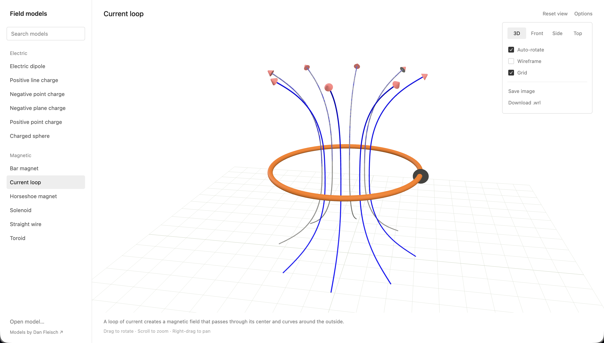

- I'm working through Dan Fleisch's book A Student's Guide for Maxwell's Equations. Noticed the [3d models](https://www.danfleisch.com/maxwell/models/index.shtml) were kinda annoying to individually download and open in a viewer. Made this: [https://alecchen.dev/fields/](https://alecchen.dev/fields/)

